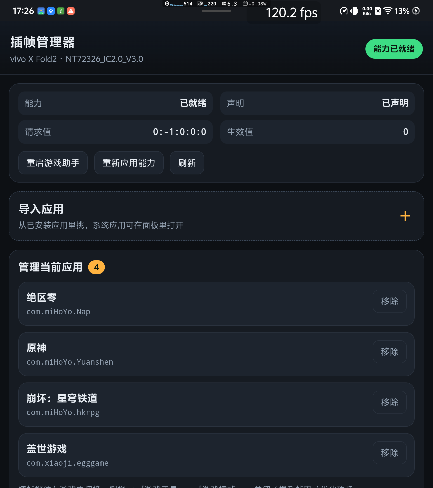
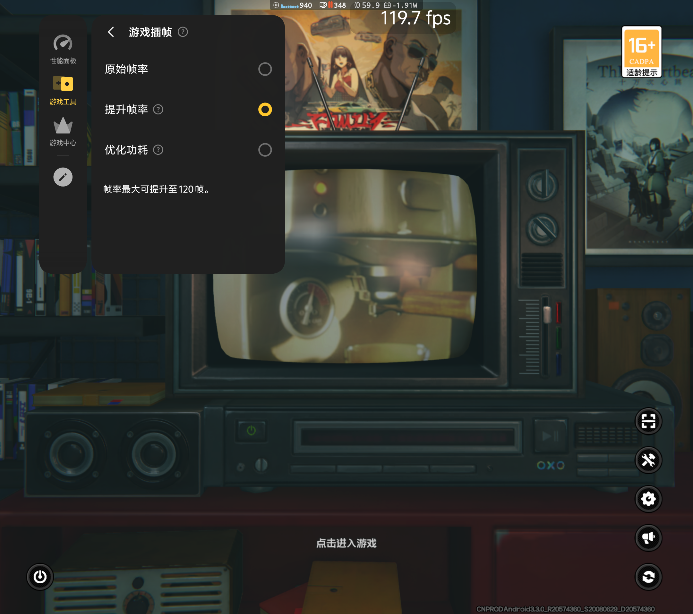

# vivo X Fold 插帧解锁

vivo 的 X Fold 折叠屏保留了显示芯片的 MEMC 插帧能力，但游戏魔盒的启用名单被裁剪，普通用户无法为任意应用打开插帧。
本模块在开机后声明 `[vivo.hardware.game.memc]` 能力，并配合游戏魔盒的 `game_dimen` 配置表，
让任意已安装应用都能在游戏侧栏里获得 **关闭 / 提升帧率(60→120) / 优化功耗(30→60)** 三档。

> **仅面向带独立 V 系列影像芯片的 vivo X Fold 系列**。安装时自动检测机型：
> X Fold2（V2266A）实测通过；X Fold3 Pro（V2337A）、X Fold6（V2545A）理论支持但未验证；
> 其余机型（含无 V 芯片的 X Fold5 / X Fold3 / X Fold+ / X Fold）与非 X Fold 机型会被拒绝安装。

## 功能

- **导入任意已安装应用**即可开启插帧，不依赖游戏魔盒自带的白名单
- 游戏内三档随时切换：原始帧率 / 提升帧率 60→120 / 优化功耗 30→60
- 进入 WebUI 自动清理「数据库里有、本机没装」的预置游戏行（有备份）
- 一键恢复游戏魔盒初始设置

## 兼容性

| 机型 | 设备型号 | 影像芯片 | 支持 |
|---|---|---|---|
| vivo X Fold2 | V2266A | V2 | ✅ 实测通过 |
| vivo X Fold3 Pro | V2337A | V3 | ⚠️ 理论支持，未验证 |
| vivo X Fold6 | V2545A | V3+ | ⚠️ 理论支持，未验证 |
| X Fold5 / X Fold3 / X Fold+ / X Fold | V2436A / V2303A / V2229A / V2178A | 无 | ⛔ 安装时拒绝 |

需要 KernelSU（在 ReSukiSU 4.2.0-rc3 / API 102、OriginOS 6 / Android 16 上验证），Magisk 未测试。

## 安装

1. 下载下方 release 里的 ZIP
2. KernelSU 管理器 → 模块 → 从本地安装
3. 重启。开机会多一次 zygote 重启（约 30 秒），属正常现象
4. 模块卡片左下角按钮打开 WebUI → 「导入应用」

## 使用

1. 打开应用，从屏幕左边缘上部滑出游戏侧栏
2. 游戏工具 → 滚动到底 → **游戏插帧**
3. 选择档位，立即生效





## 验证是否生效

```bash
adb shell settings get system gamecube_frame_interpolation   # 期望 1:9:<pid>:60:120
adb shell settings get system gamecube_memc_effective        # 期望 60
adb shell su -c 'cat /sys/rsc/vgarph/MEMC'                   # 期望 1
```

## 风险

- 修改游戏魔盒数据库与 `/vendor/etc/vivo_config.ini` 的运行时挂载，属于系统级改动，刷入前请确认可接受风险
- 写数据库前自动备份到 `/data/local/tmp/vivo-xfold-backup/`
- 本项目与 vivo 无关联，AGPL-3.0
